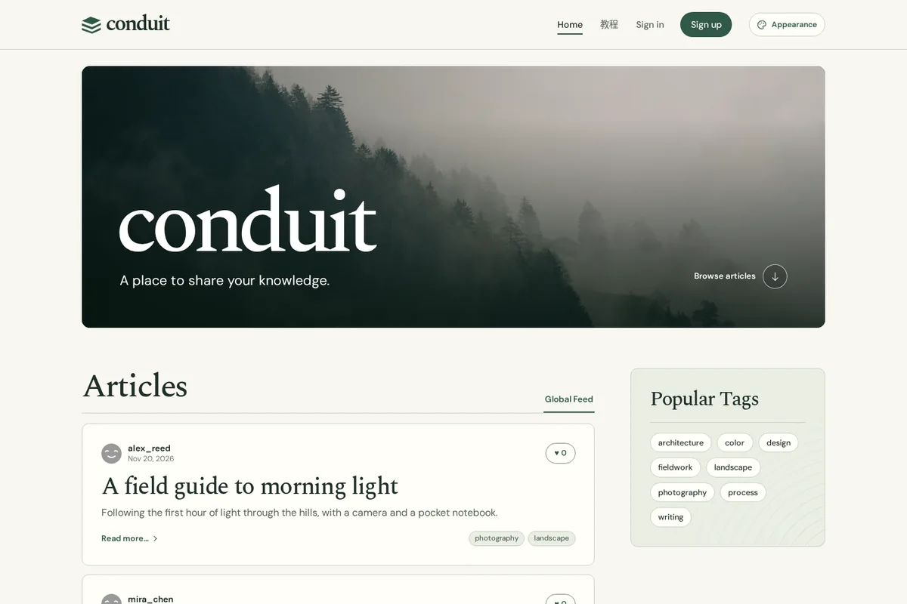
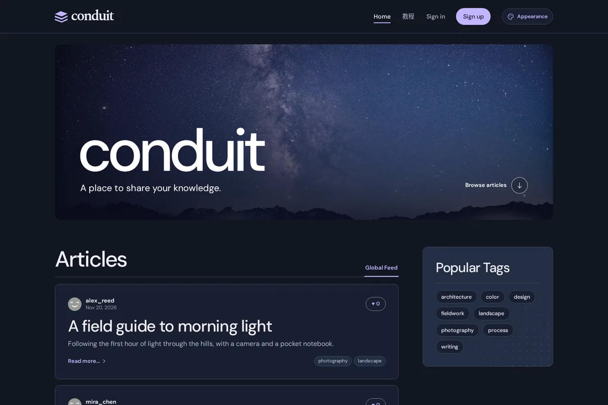
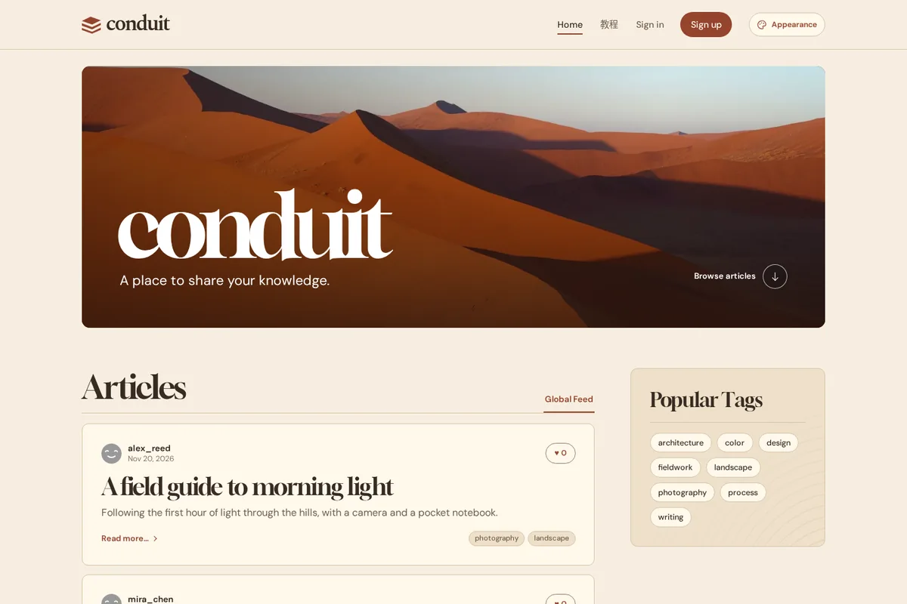
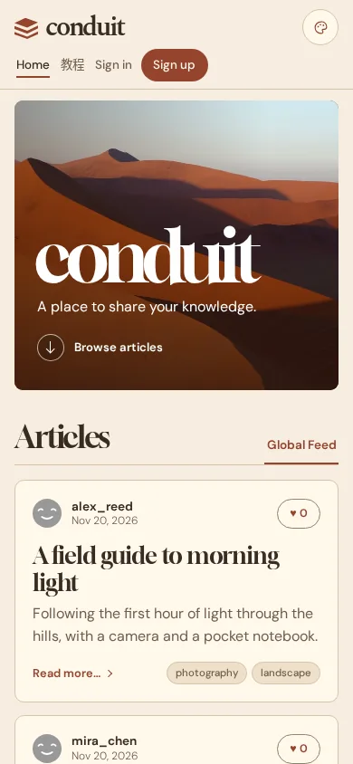
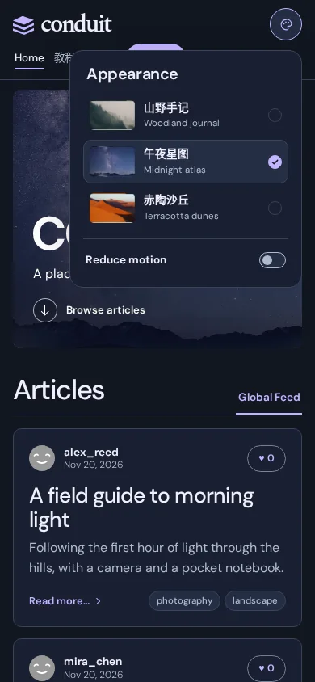

# Conduit 外观

点击导航栏的 **Appearance**（手机上的调色盘图标），即可切换整站外观。首页、文章、编辑器和中文教程会一起换肤。浏览器会记住选择，并同步到同一站点已打开的其他标签页。

## 山野手记

默认皮肤用松针绿、纸张色和衬线标题配合林间晨雾。打开首页时，一束柔光缓缓扫过封面。

[查看山野手记的文章阅读页](article.webp)

## 午夜星图

深蓝底色和淡紫色控件呼应山脊上的银河。封面的星点短暂闪烁，文章和教程也使用深色阅读背景。

[查看午夜星图的中文教程](tutorial.webp)

## 赤陶沙丘

暖砂色背景和陶土红按钮延续沙丘的颜色。封面有掠过沙面的细纹，文章标题采用粗细对比鲜明的衬线字。

[查看赤陶沙丘的 Markdown 编辑器](editor.webp)

## 手机与动效

手机首页将文章和标签排成一列。需要静态界面时，打开 **Appearance** 中的 **Reduce motion** 即可。系统已开启减少动态效果时，网站会自动采用该设置。使用键盘时，可以用方向键更换皮肤，按 Esc 返回导航栏。

 

截图中的文章来自演示用数据库。[查看封面照片及摄影师署名](../../frontend/src/appearance/covers/CREDITS.md)。
